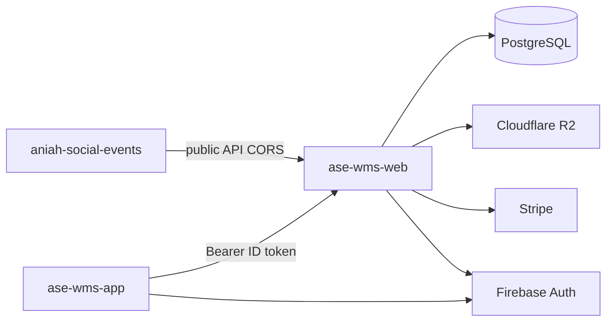
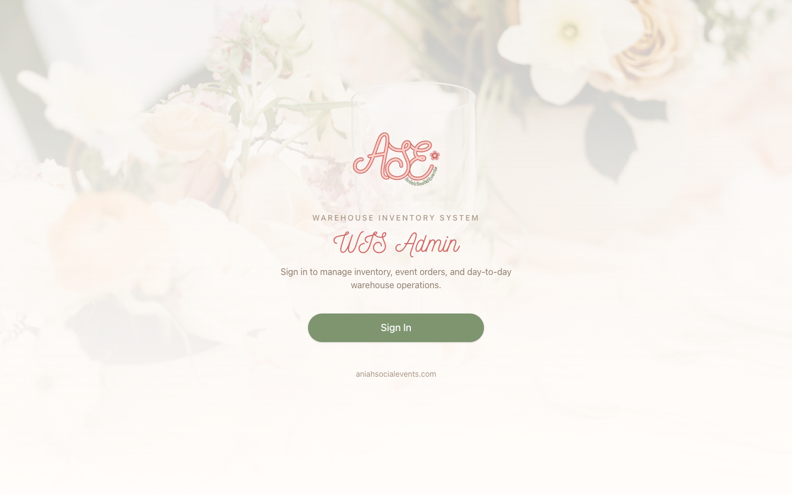
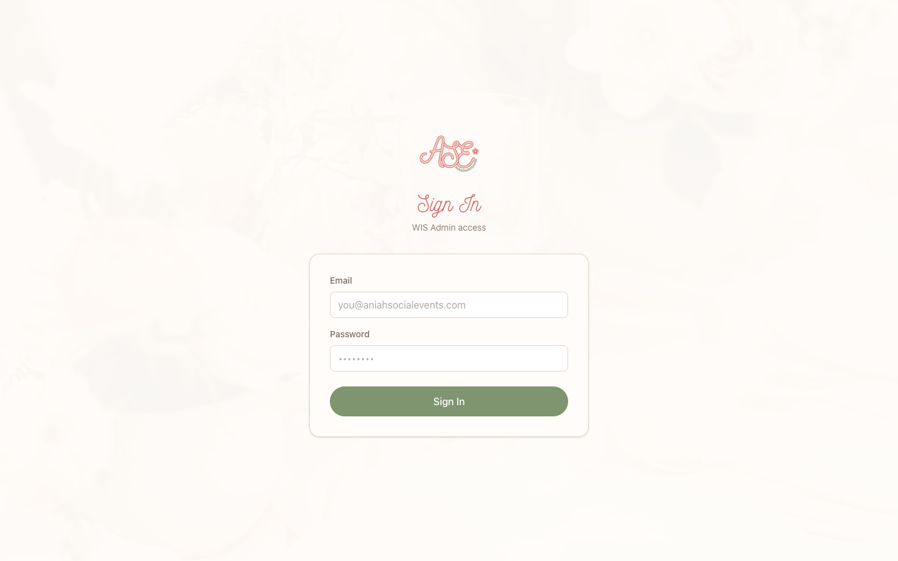
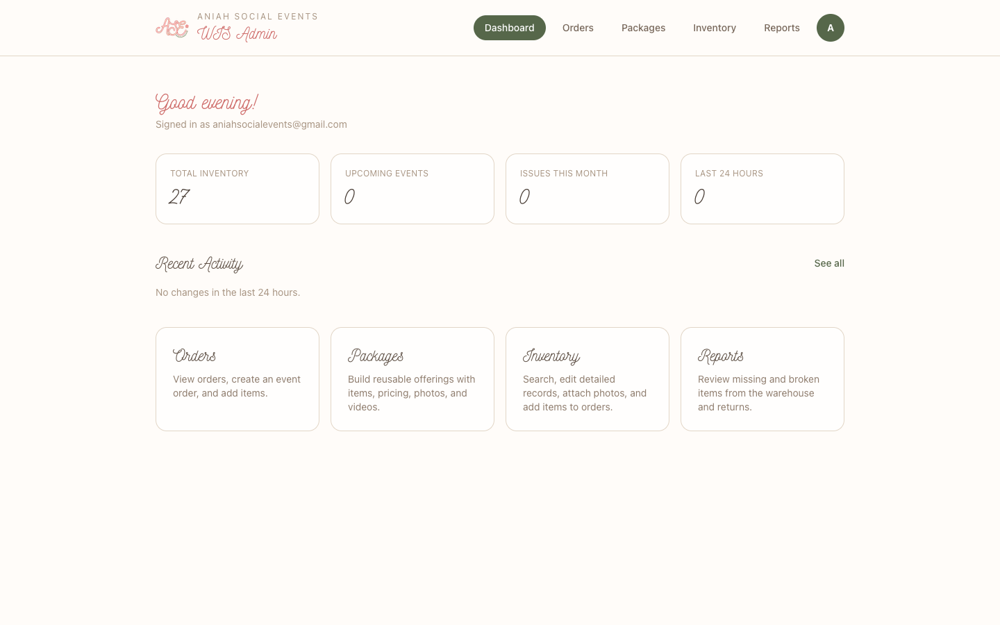
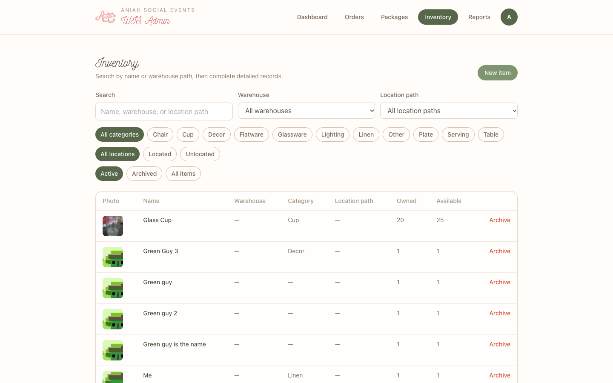
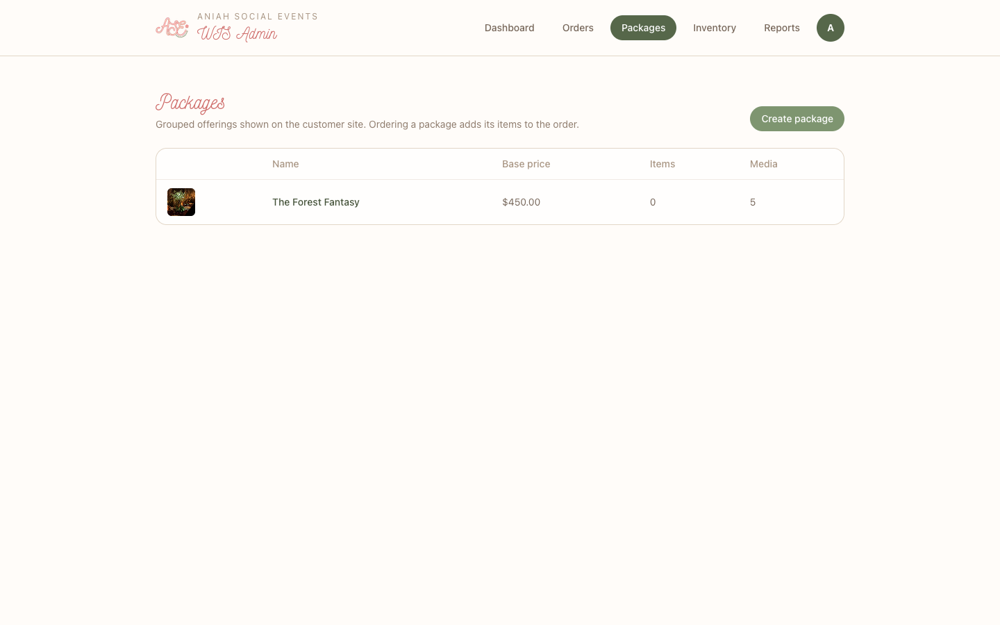

# ASE WIS Web

Admin dashboard and HTTP API for the **Aniah Social Events Warehouse Inventory System (ASE WIS)**. This is the system of record: PostgreSQL, Stripe checkout, and the routes both sibling apps call.

| Piece | Repo | Role |
| --- | --- | --- |
| Customer site | [`aniah-social-events`](https://github.com/agustindevelops/aniah-social-events) | Marketing and guest booking at [aniahsocialevents.com](https://www.aniahsocialevents.com) |
| WIS admin + API | [`ase-wms-web`](https://github.com/agustindevelops/ase-wms-web) (this project) | Catalog, packages, orders, Stripe, files |
| WIS phone app | [`ase-wms-app`](https://github.com/agustindevelops/ase-wms-app) | Floor cataloging, QR labels, pickup and return |



The marketing site never opens Postgres. The phone app never calls the marketing site. Both go through this Next.js server.

**Scope:** [Project Scope Statement - ASE WIS](https://agustindevelops.atlassian.net/wiki/spaces/ASE/pages/161775617/Project+Scope+Statement+-+ASE+WMS)

## What this app is for

An admin signs in on a computer to finish catalog records, publish packages the customer site sells, and review event orders. Pickup, return, location scanning, and NIIMBOT label printing stay on the phone.

MVP role is **Admin** (business owner). Staff-limited pick/return accounts are deferred.

## Tour

### Landing



Unsigned visitors see the branded portal. **Sign In** goes to `/signin`. Public signup is off (`allowPublicSignup = false`); accounts are pre-provisioned.

### Sign in



Email and password go to `POST /api/login`, which checks Firebase, loads the Prisma membership, and returns a custom token. The client then calls `signInWithCustomToken`. The same Firebase project is used by [`ase-wms-app`](https://github.com/agustindevelops/ase-wms-app).

### Dashboard



`/admin` shows warehouse totals, upcoming events, issues, last-24-hour activity, and shortcuts into Orders, Packages, Inventory, and Reports.

### Inventory



Search, warehouse, category, location, and archive filters. Staff typically photograph a new item on the phone; this screen is where descriptions, prices, materials, and purchase links get finished.

### Packages



A package is a grouped offering with a customer-site slug (`/intimate-celebrations/{slug}`). Creating or editing a package here is what the marketing site lists. Ordering a package copies its items onto the event order for the warehouse to pick.

## How it connects

| Client | How it talks to this repo |
| --- | --- |
| [`aniah-social-events`](https://github.com/agustindevelops/aniah-social-events) | Unauthenticated `GET`/`POST` under `/api/public/{organizationId}/…`. Env: `NEXT_PUBLIC_ASE_ADMIN_URL`, `NEXT_PUBLIC_ASE_ADMIN_ORGANIZATION_ID`. CORS: `PUBLIC_API_ALLOWED_ORIGINS`. |
| [`ase-wms-app`](https://github.com/agustindevelops/ase-wms-app) | `Authorization: Bearer <Firebase ID token>` on `/api/…`. Env: `EXPO_PUBLIC_ASE_WIS_API_URL` (include `/api`, no trailing slash). |

### Public customer API

No Firebase token. The caller must pass a real organization id. Pricing is recalculated on the server (`src/lib/order/atHomeExperience/`, kept identical to the copy in the customer site). Checkout needs `STRIPE_SECRET_KEY`; `POST /api/stripe/webhook` moves `PAYMENT_PENDING` → `PAYMENT_PROCESSED`.

| Route | Behavior |
| --- | --- |
| `GET /api/public/{organizationId}/packages` | Package catalog |
| `GET /api/public/{organizationId}/packages/{slug}` | One package |
| `GET /api/public/{organizationId}/event-dates-booked?month=YYYY-MM` | Booked days; `PAYMENT_PENDING` does not hold a day |
| `POST /api/public/{organizationId}/orders` | Create order + Stripe Checkout URL |
| `GET /api/public/{organizationId}/orders/checkout/{sessionId}` | Confirmation after payment |
| `POST /api/public/{organizationId}/uploads` | Booking photo |
| `GET /api/public/{organizationId}/uploads/{name}` | Signed photo redirect |
| `GET /api/public/{organizationId}/files/{fileId}` | Package media |

Stripe success returns the guest to `{marketing site}/intimate-celebrations/booked`.

### Authenticated phone / admin API

`wisFetch` / `aseApiFetch` attach the Firebase ID token. `requirePrismaUser` loads `User` + `OrganizationMembership`. `organizationId` comes from the verified custom claim. Warehouse routes also require that the path warehouse belongs to that organization.

| Route | Behavior |
| --- | --- |
| `GET /api/me` | User, organization, role, warehouses |
| `GET /api/dashboard/summary` | Home metrics |
| `GET /api/item` | Catalog |
| `POST /api/img/upload` | Presigned R2 PUT |
| `GET/POST /api/order/pickup` and `/api/order/return` | Today’s floor lists |
| `GET /api/warehouse/{id}` | Location tree |

### Exterior services

| Service | Role |
| --- | --- |
| PostgreSQL (Prisma 7) | All app data |
| Firebase Auth | Web + phone sign-in; Admin SDK verifies Bearer tokens |
| Cloudflare R2 | Inventory, package, and booking photos |
| Stripe | Checkout Sessions + webhook |

## Stack

| Layer | Technology |
| --- | --- |
| Framework | Next.js 15 (App Router), React 19, Tailwind CSS 4 |
| Auth | Firebase Auth (client) + Firebase Admin (Bearer verify on API) |
| Database | Prisma 7 + PostgreSQL (server-only) |
| Files | Cloudflare R2 via the S3 SDK |
| Payments | Stripe Checkout + webhook |

Branding (cream, coral, Nickainley, logos) follows [`aniah-social-events`](https://github.com/agustindevelops/aniah-social-events).

## Getting started

```bash
cp .env.example .env.local
# fill DATABASE_URL, NEXT_PUBLIC_FIREBASE_*, FIREBASE_ADMIN_CREDENTIALS_JSON
npm install
npx prisma migrate dev --name init_user
npm run db:seed
npm run dev
```

Open [http://localhost:3000](http://localhost:3000). The marketing site also defaults to 3000; run one of them on another port when both are local.

### Env checklist

See [`.env.example`](./.env.example). You need:

| Variable | Where to get it |
| --- | --- |
| `DATABASE_URL` | Prisma Console → Connect → **direct TCP** `postgres://…` |
| `NEXT_PUBLIC_FIREBASE_*` | Firebase Console → Project settings → Web app |
| `FIREBASE_ADMIN_CREDENTIALS_JSON` | Firebase Console → Service accounts → Generate private key (full JSON, one line) |
| `S3_API_URL` | `https://<accountId>.r2.cloudflarestorage.com/<bucket>` |
| `CLOUDFLARE_ACCESS_KEY_ID` / `CLOUDFLARE_ACCESS_KEY` | Cloudflare → R2 → Manage API Tokens |
| `STRIPE_SECRET_KEY` / `STRIPE_WEBHOOK_SECRET` | Stripe Dashboard (public booking) |
| `PUBLIC_API_ALLOWED_ORIGINS` | Marketing site origins allowed to call `/api/public` |

`DATABASE_URL`, `FIREBASE_ADMIN_*`, R2 keys, and Stripe secrets are **server-only** — never prefix them with `NEXT_PUBLIC_`.

Client apps never get R2 keys; they receive a short-lived `upload_url` from `POST /api/img/upload`.

### Pattern for secured API routes

```ts
import {
  isAuthFailure,
  requireFirebaseUser, // token only — no Prisma
  requirePrismaUser,   // token first, then User + organization membership
} from "@/lib/auth/requireAuth";
import { prisma } from "@/lib/db/prisma";

export async function GET(request: Request) {
  const auth = await requireFirebaseUser(request);
  if (isAuthFailure(auth)) return auth.response; // 401, no DB

  const { user, organization, role } = await requirePrismaUser(request);
}
```

## Scripts

| Command | Description |
| --- | --- |
| `npm run dev` | Development server |
| `npm run build` | `prisma generate` + production build |
| `npm run start` | Production server |
| `npm run lint` | ESLint |
| `npm run db:migrate` | Create/apply migrations |
| `npm run db:push` | Push schema without migration files |
| `npm run db:seed` | Seed lookup rows (ADMIN role, Aniah org, Lemon Tree warehouse) |
| `npm run db:studio` | Prisma Studio |

## Project layout

```
prisma/          # schema + migrations
src/
  app/           # /, /signin, /admin, /api/*
  app/api/       # Bearer APIs + /api/public + Stripe webhook
  lib/auth/      # Firebase Admin verify + requirePrismaUser
  lib/db/        # Prisma singleton
  lib/api/       # wisFetch / aseApiFetch
  lib/order/     # quotes, public booking, fulfillment
public/images/   # ASE logos + floral background
```
